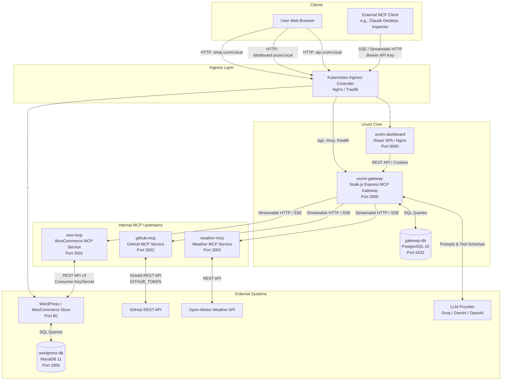
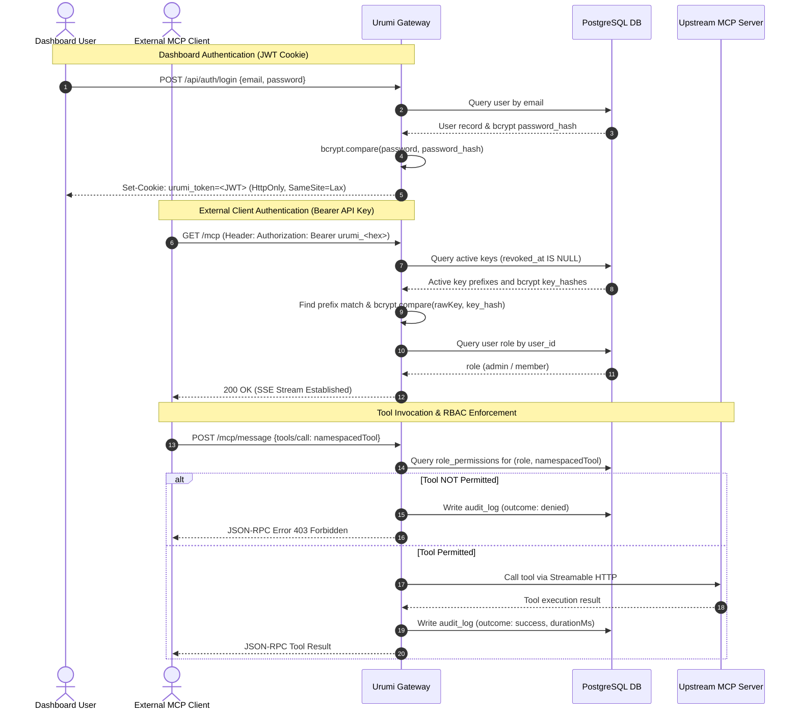

# System Design & Tradeoffs

This document details the architectural design, component responsibilities, tool discovery and routing mechanisms, security models, failure isolation strategies, local versus production deployment designs, and architectural tradeoffs of the Urumi MCP Gateway platform.

---

## 1. Architecture & Component Responsibilities

Urumi is an agentic Model Context Protocol (MCP) Gateway platform that securely aggregates, namespaces, authorizes, and proxies multiple upstream MCP microservices for Large Language Models (LLMs) and external MCP clients.

### Component Responsibilities

| Component | Technology | Primary Responsibilities |
| :--- | :--- | :--- |
| **Gateway (`urumi-gateway`)** | Node.js, Express, TypeScript, `@modelcontextprotocol/sdk` | Core orchestrator. Operates as both an MCP Client (connecting to internal upstreams) and an MCP Server (exposing `/mcp`). Enforces authentication (JWT cookies and Bearer API keys), per-tool Role-Based Access Control (RBAC), Server-Side Request Forgery (SSRF) validation, persistent audit logging, and LLM chat orchestration. |
| **Dashboard (`urumi-dashboard`)** | React 19, TypeScript, Vite, Tailwind-free Vanilla CSS | Single Page Application (SPA) serving administrative and member web workflows: user authentication, upstream server management, API key issuance/revocation, role-based tool permission toggling, audit ledger inspection, and chat assistant interface with native rendering of structured tool data. |
| **WooCommerce MCP (`woo-mcp`)** | Node.js, Express, `@woocommerce/woocommerce-rest-api` | Upstream MCP microservice exposing native tools (`list_products`, `create_product`, `get_product`, `list_orders`, `get_order`, `update_order_status`). Translates MCP JSON-RPC tool calls into WooCommerce REST API v3 operations using credentials injected via Kubernetes Secrets. |
| **GitHub MCP (`github-mcp`)** | Node.js, Express, `@octokit/rest` | Upstream MCP microservice exposing tools (`search_repositories`, `get_repo`, `list_issues`, `create_issue`). Authenticates to GitHub via a shared `GITHUB_TOKEN`. |
| **Weather MCP (`weather-mcp`)** | Node.js, Express, Open-Meteo REST | Upstream MCP microservice exposing tools (`get_weather`, `get_forecast`). Queries Open-Meteo REST endpoints for coordinates without requiring external authentication tokens. |
| **Gateway DB (`gateway-db`)** | PostgreSQL 15, Drizzle ORM | Relational storage for users, roles, password hashes, hashed API keys, upstream server records, encrypted upstream credentials (AES-256-GCM), role tool permissions, and persistent audit log entries. |
| **Storefront & DB (`wordpress` & `wordpress-db`)** | WordPress 6.7, WooCommerce 8.7, MariaDB 11 | Complete e-commerce store with product catalog, cart, and Cash on Delivery (COD) checkout. Provides administrative back-office at `/wp-admin` for order fulfillment and catalog auditing. |
| **Ingress Controller** | Ingress-Nginx (Local Kind) / Traefik (Production k3s) | Central layer-7 ingress router dispatching incoming HTTP host requests to respective services based on host headers. |

---

## 2. Tool Discovery, Aggregation, Namespacing, and Routing

### Tool Discovery & Aggregation
Upon Gateway startup (`clientManager.initializeAll()`) or when an administrator enables a server, the Gateway connects to each enabled upstream MCP server via `Client.connect(transport)` and executes `client.listTools()`. The received tools are stored in the Gateway's in-memory `registry`.

### Deterministic Collision-Safe Namespacing
To prevent collisions between different upstreams exposing identical tool names (e.g., if both `woo-mcp` and `github-mcp` defined a `search` tool), the Gateway enforces deterministic namespacing:
$$\text{namespacedName} = \text{serverName} + \texttt{"\_\_"} + \text{originalToolName}$$

Examples:
- `woocommerce` + `list_products` $\rightarrow$ `woocommerce__list_products`
- `weather` + `get_weather` $\rightarrow$ `weather__get_weather`
- `github` + `list_issues` $\rightarrow$ `github__list_issues`

The `registry` stores each registered tool with:
- `namespacedName`: The fully qualified unique identifier exposed to clients.
- `serverName`: The upstream server identifier (e.g., `woocommerce`).
- `serverId`: The relational database ID of the upstream server.
- `originalToolName`: The raw tool name expected by the upstream microservice.
- `description` & `inputSchema`: Schemas provided directly by the upstream.

### Tool Routing Execution
When an authorized invocation is received:
1. The Gateway resolves the namespaced tool identifier in `registry`.
2. It validates that the authenticated caller's role (`admin` or `member`) has explicit permission to execute the tool via `isToolAllowed(role, namespacedTool)`.
3. It extracts `serverName` and `originalToolName`.
4. It strips `null` arguments to conform with strict upstream JSON schemas (`stripNullArgs`).
5. It executes the call on the upstream connection using `clientManager.callToolWithTimeout(serverName, originalToolName, args)` with a timeout bounded between 1 and 300 seconds (default: 30 seconds).
6. It captures execution metrics and logs an audit record before returning the result to the caller.

---

## 3. Authentication & Authorization Flow

The platform supports two distinct authentication mechanisms depending on the client interface:

### 1. Dashboard User Authentication
- Handled at `POST /api/auth/login`.
- Passwords are verified against 10-round salted `bcrypt` hashes stored in the `users` table.
- Issues a JSON Web Token (JWT) signed with HMAC-SHA256 using `JWT_SECRET` (minimum 32 characters required at startup).
- The JWT is stored in an `HttpOnly`, `SameSite=Lax` cookie named `urumi_token`, containing `id`, `email`, and `role`.

### 2. External MCP Client Authentication
- Handled at `/mcp` via the `Authorization: Bearer <API_KEY>` HTTP header.
- API keys are issued via `POST /api/api-keys` with the format `urumi_<64-hex-characters>`.
- The raw key is returned exactly once to the user upon creation.
- The Gateway stores only the `key_prefix` (first 10 characters) and a salted `bcrypt` hash (`key_hash`).
- On incoming requests, the Gateway filters active keys (`revoked_at IS NULL`), matches candidate keys by prefix, and validates the full key using `bcrypt.compare`.
- Revocation (`DELETE /api/api-keys/:id`) sets `revoked_at = NOW()`. Subsequent requests with revoked keys are immediately rejected with `401 Unauthorized` without requiring restart.

### 3. Role-Based Access Control (RBAC) Enforcement
- **Roles:** `admin` and `member`.
- `admin` has unrestricted access to all tools, server management, member administration, and audit logs.
- `member` access is strictly governed by the `role_permissions` table on a per-namespaced-tool basis.
- Enforced at three levels:
  1. **Chat Agent Context Filtering:** The LLM is provided schemas *only* for tools the user is permitted to run.
  2. **External MCP Discovery Filtering:** `tools/list` on `/mcp` returns only tools permitted for the caller's role.
  3. **Direct Execution Interception:** Even if an LLM hallucinates an unauthorized tool or an external client sends a handcrafted `tools/call`, the Gateway blocks execution before invoking upstream microservices, returning HTTP/JSON-RPC 403 and logging a `denied` audit entry.

---

## 4. Upstream Timeouts & Failure Isolation

### Timeout Enforcement
Every upstream tool call is wrapped in a strict timeout promise via `clientManager.callToolWithTimeout`:
- Individual server timeout configuration is stored in `upstream_servers.timeout_ms` (clamped between 1,000 ms and 300,000 ms; default: 30,000 ms).
- If the upstream fails to respond within this interval, the promise rejects with `new Error("Timeout")`.
- The Gateway handles the timeout gracefully:
  - It constructs a friendly error response: `{ content: [{ type: "text", text: "Error: Upstream server timed out" }], isError: true }`.
  - It records an audit log with `outcome: "timeout"`.
  - The Gateway process and other concurrent requests remain healthy and unblocked.

### Failure Isolation Across Upstreams
- All upstream microservices (`woo-mcp`, `github-mcp`, `weather-mcp`) run in independent Kubernetes Pods.
- Internal client sessions are managed independently within `clientManager`.
- If an upstream microservice crashes, returns HTTP 500 errors, or is terminated:
  - Only calls directed to that specific server fail.
  - The failure is isolated; other upstreams continue processing tool calls normally.
  - Hard errors trigger `clientManager.markServerFailed`, transitioning the server status in PostgreSQL to `error` and dropping its tools from the registry to prevent cascading failures.

---

## 5. Upstream Disablement & Unreachability Behavior

### Administrative Disablement
When an administrator disables an upstream via `POST /api/servers/:id/disable`:
1. Gateway executes `clientManager.disconnectServer(serverName)`.
2. The active MCP client connection is closed immediately.
3. All registered tools for that server are purged from the Gateway's registry (`registry.clearServerTools(serverName)`).
4. Any active reconnection backoff timers are canceled.
5. Upstream record in PostgreSQL is updated to `status: "disconnected"`, `status_message: "Disabled by user"`.
6. Subsequent `tools/list` requests or chat interactions immediately omit the disabled server's tools.

### Upstream Unreachability & Auto-Recovery
The Gateway runs a background health check loop every 30 seconds (`clientManager.startHealthCheckLoop`):
1. **Health Verification:** For connected servers, the Gateway executes `listToolsWithTimeout` (10s timeout).
2. **Failure Handling:** If the check fails or a connection is lost, `markServerFailed` is invoked:
   - Upstream tools are cleared from the registry.
   - Server status updates to `status: "error"`.
   - The server enters an exponential backoff reconnection schedule:
     $$\text{delay} = \min\left(60000\text{ ms},\, 5000\text{ ms} \times 2^{\text{attempts} - 1}\right) + \text{jitter}$$
3. **Auto-Recovery:** When the failing pod restarts or recovers network connectivity:
   - The reconnection loop re-establishes the MCP client session.
   - Tools are dynamically re-synced and re-registered into the active registry.
   - Server status in PostgreSQL returns to `connected`, `status_message: "OK"`.
   - The tools immediately become discoverable and executable again.

---

## 6. Chat Agent Tool Invocation & User Attribution

The Chat Agent (`/api/chat`) orchestrates multi-turn LLM reasoning with automated tool execution:

1. **User Identity & Role:** The Gateway extracts `userId` and `userRole` from the verified JWT cookie (`req.user`).
2. **Context Assembly:**
   - The Gateway queries `registry.getAllTools()` and filters them against `isToolAllowed(userRole, tool.namespacedName)`.
   - A system prompt establishes agent identity, current date, and instructions for concise outputs.
   - The LLM provider (Groq, Gemini, or OpenAI compatible) is called with conversation history and the filtered tool definitions.
3. **Tool Execution Loop:**
   - If the LLM generates one or more tool calls:
     - The Gateway intercepts the tool call before dispatching.
     - It verifies tool presence in the registry and confirms user permissions.
     - If unauthorized, execution halts, a user-friendly denial message is generated, and a `denied` audit entry is recorded.
     - If authorized, the tool is executed via `clientManager.callToolWithTimeout`.
     - Tool results are converted to text and appended as a `tool` role message for the next LLM turn (up to 5 iterations).
4. **User Attribution & Audit Logging:**
   - Every executed tool call (whether successful, failed, timed out, or denied) writes to the `audit_logs` table:
     - `userId`: Captured from the authenticated session.
     - `serverId`: Associated upstream server database ID.
     - `namespacedTool`: Fully qualified tool name (e.g., `woocommerce__create_product`).
     - `toolName`: Original upstream tool name (e.g., `create_product`).
     - `requestParams`: Full JSON argument payload.
     - `outcome`: `success`, `error`, `timeout`, or `denied`.
     - `durationMs`: High-resolution elapsed time.
     - `source`: `"chat-agent"` or `"mcp-client"`.
     - `startedAt` & `completedAt`: Precise ISO timestamps.

---

## 7. Local vs. Production Deployment Differences

The repository uses an identical unified Helm chart (`infra/helm/urumi`), adapting environments cleanly via values files:

| Dimension | Local Development (`values-local.yaml`) | Production VPS / k3s (`values-prod.yaml`) |
| :--- | :--- | :--- |
| **Cluster Runtime** | Local Kind cluster (`urumi-local`) on Docker | Lightweight k3s or managed Kubernetes on Linux VPS |
| **DNS Resolution** | Static `/etc/hosts` mappings pointing to `127.0.0.1` (`shop.urumi.local`, `api.urumi.local`, `dashboard.urumi.local`) | Public DNS A/CNAME records pointing to VPS public IP (`shop.example.com`, etc.) |
| **Ingress Controller** | `ingress-nginx` (applied directly to Kind via nodePort 80/443) | `traefik` (k3s built-in default) or `ingress-nginx` |
| **TLS / SSL** | Plain HTTP | Terminated at Ingress / Load Balancer or via `cert-manager` |
| **Container Images** | Locally built Docker images loaded directly into Kind runtime (`imagePullPolicy: Never`) | Remote container registry images (`ghcr.io/...`, `pullPolicy: IfNotPresent`) |
| **Storage Class** | Default Kind HostPath storage | `local-path` (k3s default) or cloud provider CSI (`gp3`, `standard`) |
| **Database Replicas** | Single replica (PostgreSQL & MariaDB) | Single replica StatefulSets with persistent volume retention |
| **Application Replicas**| Single replica for all workloads | Scaled stateless workloads (`dashboard: 2`, `githubMcp: 2`, `weatherMcp: 2`); `gateway: 1` (SSE constraint); `wordpress: 1` (RWO constraint) |
| **Secret Provisioning**| Local test credentials (`admin123` / `member123`) committed to values file | Empty placeholders; credentials passed at deploy time via `--set` or private secret files |

---

## 8. Architectural Tradeoffs, Limitations & Future Work

### 1. Gateway Replica Constraints (In-Memory SSE Sessions)
- **Current Design:** The Gateway stores active Server-Sent Events (SSE) client transport connections in local process memory (`sseTransports` map in `apps/gateway/src/mcp/server.ts`).
- **Tradeoff:** Simplifies transport lifecycle management and avoids external cache dependencies.
- **Limitation:** Running multiple Gateway replicas causes message routing failures. If an external client connects via SSE to Gateway Pod A and posts a message to Gateway Pod B, Pod B returns `404 Session not found`.
- **Mitigation / Future Work:** `gateway.replicas` must remain at 1 until session state is migrated to a shared store (e.g., Redis) or session affinity / sticky sessions are configured at the Ingress controller.

### 2. Shared Upstream Credentials (No Per-User Upstream Tokens)
- **Current Design:** Upstream MCP servers authenticate to third-party APIs (WooCommerce REST, GitHub) using shared platform credentials injected via environment variables or decrypted database entries.
- **Tradeoff:** Enables frictionless team member access without forcing each user to configure individual API keys.
- **Limitation:** Actions executed on upstream systems occur under the identity of the shared credential, not individual members. Member-level isolation relies completely on Gateway RBAC and audit log attribution.
- **Future Work:** Introduce per-user OAuth2 token passthrough or upstream credential mapping.

### 3. WordPress Single-Replica Constraint (ReadWriteOnce Storage)
- **Current Design:** WordPress uses a standard PersistentVolumeClaim with `accessModes: [ReadWriteOnce]`.
- **Tradeoff:** Compatible with default local and k3s `local-path` storage providers without requiring distributed filesystems.
- **Limitation:** WordPress cannot scale horizontally (`replicas > 1`) because multiple pods cannot attach to the same RWO volume. Multiple pods with independent local storage would cause upload split-brain.
- **Mitigation / Future Work:** Keep `wordpress.replicas: 1`. For high availability, configure ReadWriteMany (RWX) storage (NFS) or an S3 object storage plugin for `/var/www/html/wp-content/uploads`.

### 4. Ingress Template TLS Limitations
- **Current Design:** The Helm Ingress template defines HTTP rules without explicit `tls:` blocks or automated `cert-manager` annotations.
- **Tradeoff:** Minimizes configuration complexity for local development across multiple domains.
- **Limitation:** Production TLS termination must be provided either globally by the ingress controller's default TLS certificate, an upstream cloud load balancer, or by manually customizing the Ingress annotations.
